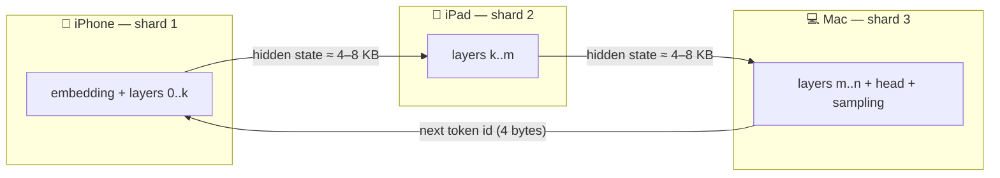

# edge-llm-cluster

**Turn the old Apple devices in your drawer into one distributed inference machine.**

Run an LLM that is too big for any one of your devices by splitting its layers across an iPhone, an iPad, and a Mac on the same Wi-Fi network — fully offline, no cloud, no API keys. Built on [MLX](https://github.com/ml-explore/mlx-swift) and pipeline parallelism.

[](https://github.com/meliharik/edge-llm-cluster/actions/workflows/ci.yml)


[](LICENSE)
[](CONTRIBUTING.md)

> 🎬 *Demo video coming with Phase 3 — three devices, router's WAN cable unplugged, tokens streaming across screens.*

---

## Why

- Modern phones and tablets have serious neural compute and unified memory — but each device alone caps out at small models.
- A 7B+ model that won't fit on a single iPhone **does** fit on an iPhone + iPad + Mac together.
- Old devices aren't e-waste. They're pipeline stages.

Projects like [exo](https://github.com/exo-explore/exo) showed distributed MLX inference across Macs. This project targets the harder, more interesting end: **heterogeneous Apple devices, including phones**, with a Swift-native stack that runs the same codebase on iOS, iPadOS, and macOS.

## How it works

The transformer's layer stack is split into contiguous shards, one per device, sized proportionally to each device's usable memory:



**Pipeline parallelism, not tensor parallelism.** Per generated token, only one small hidden-state vector crosses each device boundary — `hidden_dim × 2 bytes` (≈ 4 KB for a 3B model, ≈ 8 KB for 8B). Three devices means three small network hops per token (two hidden states + the sampled token id looping back to the embedding shard). On local Wi-Fi that adds a few milliseconds per hop — the network is not the bottleneck. Tensor parallelism, by contrast, would need synchronization inside every layer and would drown Wi-Fi immediately.

**KV caches never travel.** Each device keeps the key/value cache for its own layers. The only things on the wire are hidden states, token ids, and control messages — framed in a compact binary format (`TensorFrame`, see [docs/ARCHITECTURE.md](docs/ARCHITECTURE.md)).

**Zero configuration.** Devices find each other with Bonjour (`Network.framework`) and negotiate a layer assignment based on reported memory. No IP addresses to type.

## Project status

| Phase | Goal | Status |
|---|---|---|
| **0 — Feasibility** | Split a model into layer-range shards, hand hidden states across a serialization boundary, prove token-exact equality with the unsharded model — on one machine | ✅ code complete, [`pipeline-proof`](Sources/PipelineProof) |
| **1 — Two devices** | Bonjour discovery + TCP tensor transport between Mac and iPhone | 🔨 transport layer ready ([`EdgeLLMTransport`](Sources/EdgeLLMTransport)), worker app in progress |
| **2 — Three devices** | Memory-proportional layer allocation, a 7B–8B model across iPhone + iPad + Mac | ⏳ planned |
| **3 — Demo polish** | Cluster visualization UI, live per-device metrics, demo video | ⏳ planned |

See [docs/ROADMAP.md](docs/ROADMAP.md) for the detailed plan.

## Quick start (Phase 0 proof)

Requirements: **Apple Silicon Mac**, **Xcode 26 / Swift 6.2+**, ~1 GB disk for the test model.

```bash
git clone https://github.com/meliharik/edge-llm-cluster.git
cd edge-llm-cluster
swift run -c release pipeline-proof
```

First run downloads `mlx-community/Qwen2.5-0.5B-Instruct-4bit` (~280 MB), then:

1. generates a reference answer with the **unsharded** model,
2. splits the same model into **two shards**, serializes every hidden state crossing the boundary through the real wire format, and generates again,
3. verifies both runs match **token for token** and prints tokens/sec plus bytes-per-token boundary traffic.

Options:

```bash
swift run -c release pipeline-proof \
  --model mlx-community/Qwen2.5-3B-Instruct-4bit \
  --prompt "Why is the sky blue?" \
  --max-tokens 128 \
  --split 18
```

Any `qwen2`-family MLX checkpoint from [mlx-community](https://huggingface.co/mlx-community) works.

## Repository layout

```
Sources/
  EdgeLLMKit/        model sharding core — Qwen2Shard, ShardLoader,
                     ShardSpec, TensorFrame codec, PipelineGenerator
  EdgeLLMTransport/  Bonjour discovery + length-prefixed TCP frames
  PipelineProof/     Phase 0 executable (single-machine proof)
Tests/
  EdgeLLMKitTests/   pure-Swift tests (wire format, layer allocation)
docs/
  ARCHITECTURE.md    design deep-dive: message flow, framing, memory math
  ROADMAP.md         phased plan with checklists
  SETUP.md           build, run, and publish instructions
```

## Honest performance expectations

The goal is **possible**, not fast. Token-by-token pipeline generation keeps only one device busy at a time, so the cluster does not add speed — it adds *memory*. Targets: ≥ 15 tok/s for a 3B model, ≥ 5 tok/s for 7B–8B across three devices. That is comfortable reading speed, produced by hardware that would otherwise sit in a drawer.

Numeric note: heterogeneous GPUs may accumulate float16 in different orders, so cross-device runs are compared *token-for-token against a same-machine reference* rather than bitwise.

## FAQ

**Why not tensor parallelism?** It needs an all-reduce inside every attention/MLP block — hundreds of round-trips per token. Wi-Fi latency makes that a non-starter; pipeline parallelism needs exactly one hand-off per shard per token.

**Why not MultipeerConnectivity?** `Network.framework` with Bonjour gives predictable TCP throughput and full control over framing; MPC's transport selection is opaque.

**Why copy the Qwen2 architecture instead of using MLXLLM's models directly?** Sharding needs surgical access to the layer stack (build layers `k..<m` only, feed hidden states in and out). Upstream model internals aren't public API, so `EdgeLLMKit` owns a minimal, shard-aware port — weight-compatible with any `qwen2` MLX checkpoint.

**Does a 7B model really not fit on one iPhone?** A 4-bit 7B is ~4 GB of weights; with iOS's per-app memory ceiling it is right at the edge on an 8 GB iPhone and impossible below that. The point of the cluster is to make the *comfortable* thing (7B–8B with real context) run on devices where it otherwise can't — and to scale to models none of the devices could ever hold alone.

## Acknowledgments

- [MLX](https://github.com/ml-explore/mlx-swift) & [mlx-swift-lm](https://github.com/ml-explore/mlx-swift-lm) — Apple's ML stack for Apple silicon; the shard model is adapted from mlx-swift-lm's Qwen2 implementation (MIT).
- [exo](https://github.com/exo-explore/exo) — inspiration for device-cluster inference.
- [llama.cpp RPC](https://github.com/ggml-org/llama.cpp/tree/master/tools/rpc) — prior art for distributed GGML inference.

## Contributing

Issues and PRs are welcome — see [CONTRIBUTING.md](CONTRIBUTING.md). Running a phase on hardware not yet in the results table and reporting numbers (there is a [device-report issue template](.github/ISSUE_TEMPLATE/device_report.md)) is the single most useful contribution right now.

## License

[MIT](LICENSE) © 2026 Melih Arık
