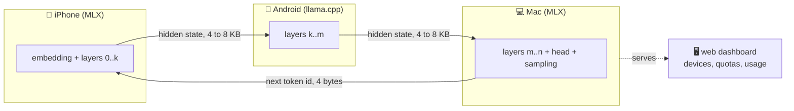
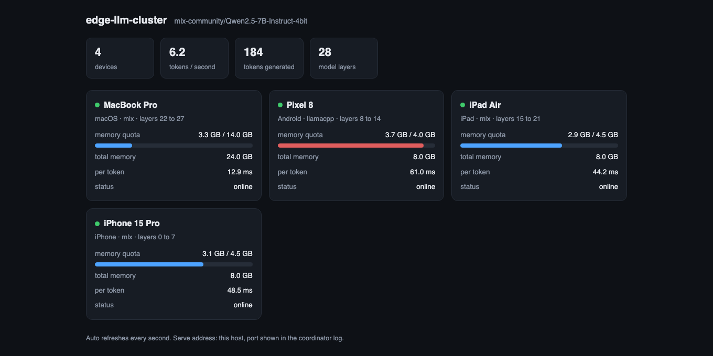

# edge-llm-cluster

**Turn the spare devices in your drawer into one distributed inference machine.**

Run an LLM that is too big for any one of your devices by splitting its layers across the phones, tablets and laptops on your Wi-Fi network. Fully offline, no cloud, no API keys. Apple devices run [MLX](https://github.com/ml-explore/mlx-swift); the wire protocol is open and platform agnostic, so Android and Linux workers can join the same cluster. A built-in web dashboard shows every connected device, its memory quota and its live usage.

[](https://github.com/meliharik/edge-llm-cluster/actions/workflows/ci.yml)


[](LICENSE)
[](CONTRIBUTING.md)

<sub>*Android and Linux join through the open [wire protocol](docs/PROTOCOL.md); the reference worker for them is on the roadmap.</sub>

> 🎬 *Demo video coming with Phase 3: several devices, router's WAN cable unplugged, tokens streaming across screens.*

## Why

- Modern phones and tablets have serious compute and memory, but each device alone caps out at small models.
- A 7B+ model that will not fit on a single phone does fit on a phone, a tablet and a laptop together.
- Old devices are not e-waste. They are pipeline stages.

Projects like [exo](https://github.com/exo-explore/exo) showed distributed MLX inference across Macs. This project targets the harder, more interesting end: heterogeneous devices, phones included, joined by an open protocol that any runtime can implement.

## How it works

The transformer's layer stack is split into contiguous shards, one per device, sized proportionally to each device's usable memory. Any number of devices can join; the split adapts.



**Pipeline parallelism, not tensor parallelism.** Per generated token, only one small hidden state vector crosses each device boundary: `hidden_dim x 2 bytes` (about 4 KB for a 3B model, about 8 KB for 8B). With N devices there are N small network hops per token. On local Wi-Fi that adds a few milliseconds per hop; the network is not the bottleneck. Tensor parallelism, by contrast, would need synchronization inside every layer and would drown Wi-Fi immediately.

**KV caches never travel.** Each device keeps the key/value cache for its own layers. The only things on the wire are hidden states, token ids and control messages, framed in a compact binary format that is fully specified in [docs/PROTOCOL.md](docs/PROTOCOL.md).

**Any runtime can join.** The protocol is deliberately runtime neutral: Apple workers use MLX, and a worker built on llama.cpp (which runs on Android and Linux) speaks the exact same frames. If your device can compute layers k through m and push float16 tensors over TCP, it can join.

**Zero configuration.** Devices find each other with mDNS/DNS-SD (Bonjour on Apple platforms, `NsdManager` on Android) and get their layer assignment based on reported memory. No IP addresses to type.

## Web dashboard

The coordinator serves a live dashboard on the local network: every connected device with its platform and runtime, memory quota and current usage, assigned layer range, per token latency, online state, plus cluster level tokens per second. It is a single self-contained page, viewable from any browser on the network, phones included.



Try it right now without any workers:

```bash
swift run edge-coordinator --demo
# then open http://localhost:8080
```

`--demo` seeds simulated devices (including an Android one) so you can see exactly what a running cluster looks like. Without the flag, the coordinator advertises the cluster service and waits for real workers.

## Project status

| Phase | Goal | Status |
|---|---|---|
| 0: Feasibility | Split a model into layer shards, hand hidden states across a serialization boundary, prove token exact equality with the unsharded model on one machine | ✅ done, verified in CI: [`pipeline-proof`](Sources/PipelineProof) |
| 1: First real cluster | Coordinator with discovery, worker sessions and web dashboard; Swift worker over TCP | 🔨 coordinator + dashboard + transport ready, worker CLI in progress |
| 2: Many devices | Memory proportional allocation, a 7B or 8B model across three or more devices, failure handling | ⏳ planned |
| 3: Demo polish | Token flow animation in the dashboard, side by side OOM comparison, demo video | ⏳ planned |
| 4: Beyond Apple | Reference Android worker (Kotlin + llama.cpp) speaking the open protocol | ⏳ planned |

See [docs/ROADMAP.md](docs/ROADMAP.md) for details.

## Quick start

Requirements for the coordinator and the Phase 0 proof: Apple Silicon Mac, Xcode 26 or newer (Swift 6.2+), about 1 GB disk for the test model.

```bash
git clone https://github.com/meliharik/edge-llm-cluster.git
cd edge-llm-cluster

# the Phase 0 proof: sharded output must match the unsharded model token for token
swift run -c release pipeline-proof

# the dashboard with simulated devices
swift run edge-coordinator --demo
```

The proof downloads `mlx-community/Qwen2.5-0.5B-Instruct-4bit` (about 280 MB) on first run, generates a reference answer with the unsharded model, splits the same model into two shards with every boundary tensor round-tripped through the real wire format, and verifies both runs match token for token. Options:

```bash
swift run -c release pipeline-proof \
  --model mlx-community/Qwen2.5-3B-Instruct-4bit \
  --prompt "Why is the sky blue?" \
  --max-tokens 128 \
  --split 18
```

Any `qwen2` family MLX checkpoint from [mlx-community](https://huggingface.co/mlx-community) works.

## Repository layout

```
Sources/
  EdgeLLMKit/          sharding core: Qwen2Shard, ShardLoader, ShardSpec,
                       TensorFrame codec, ControlMessage, PipelineGenerator
  EdgeLLMTransport/    mDNS discovery + length prefixed TCP frames
  EdgeLLMCoordinator/  cluster state + web dashboard server
  EdgeCoordinatorCLI/  the edge-coordinator executable
  PipelineProof/       Phase 0 executable (single machine proof)
Tests/                 pure Swift tests: wire format, allocation, cluster state
docs/
  PROTOCOL.md          the open wire protocol (implement this to join from any platform)
  ARCHITECTURE.md      design deep dive: message flow, framing, memory math
  ROADMAP.md           phased plan
  SETUP.md             build and run instructions
```

## Honest performance expectations

The goal is possible, not fast. Token by token pipeline generation keeps only one device busy at a time, so the cluster does not add speed; it adds memory. Targets: at least 15 tok/s for a 3B model, at least 5 tok/s for 7B or 8B across three devices. That is comfortable reading speed, produced by hardware that would otherwise sit in a drawer.

Numeric note: different GPUs and runtimes may accumulate float16 in different orders, so cross device runs are compared against a same machine reference at the text level rather than bitwise.

## FAQ

**Why not tensor parallelism?** It needs an all-reduce inside every attention and MLP block, hundreds of round trips per token. Wi-Fi latency makes that a non-starter; pipeline parallelism needs exactly one hand-off per shard per token.

**How does Android fit in if the core is MLX?** MLX only runs on Apple silicon, but nothing else in the system cares which runtime a worker uses. The protocol exchanges plain float16 tensors at shard boundaries. llama.cpp runs well on Android, can execute partial layer ranges through its C API, and GGUF checkpoints of the same base model line up layer for layer with the MLX ones. [docs/PROTOCOL.md](docs/PROTOCOL.md) is written precisely so that worker can be built without reading any Swift.

**Is there a limit on the number of devices?** No hard limit. Allocation is proportional to usable memory with a minimum of one layer per device, so a model with N layers supports up to N workers. Each extra device adds one network hop of latency per token.

**Why copy the Qwen2 architecture instead of using MLXLLM's models directly?** Sharding needs surgical access to the layer stack: build layers k through m only, feed hidden states in and out. Upstream model internals are not public API, so `EdgeLLMKit` owns a minimal, shard aware port that stays weight compatible with any `qwen2` MLX checkpoint.

**Does a 7B model really not fit on one phone?** A 4-bit 7B is about 4 GB of weights; with the per app memory ceiling on phones it is right at the edge on 8 GB devices and impossible below that. The cluster makes the comfortable thing (7B or 8B with real context) run where it otherwise cannot, and scales to models none of the devices could ever hold alone.

## Contributing

Issues and PRs are welcome; see [CONTRIBUTING.md](CONTRIBUTING.md). The single most useful contribution right now is running a phase on hardware not yet in the results and reporting numbers through the device report issue template. Second most useful: a llama.cpp worker speaking [the protocol](docs/PROTOCOL.md).

## Acknowledgments

- [MLX](https://github.com/ml-explore/mlx-swift) and [mlx-swift-lm](https://github.com/ml-explore/mlx-swift-lm): Apple's ML stack for Apple silicon; the shard model is adapted from mlx-swift-lm's Qwen2 implementation (MIT).
- [exo](https://github.com/exo-explore/exo): inspiration for device cluster inference.
- [llama.cpp](https://github.com/ggml-org/llama.cpp): the intended runtime for non Apple workers.

## License

[MIT](LICENSE) © 2026 Melih Arık
